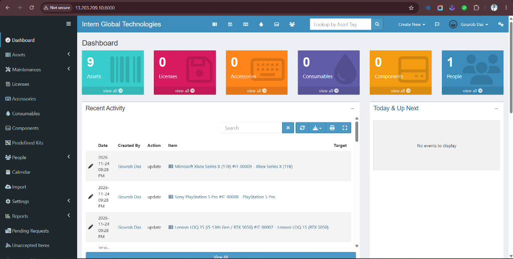
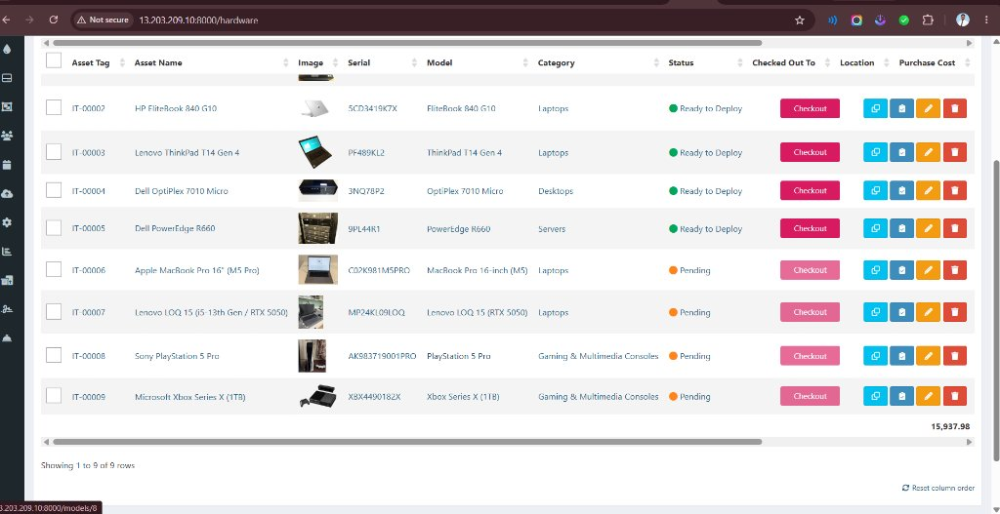
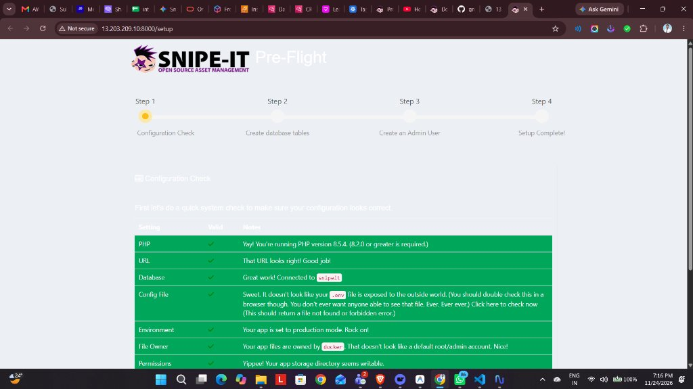

# Enterprise Snipe-IT ITAM Deployment on AWS EC2 with Docker & Terraform

This repository provides an automated, production-ready Infrastructure as Code (IaC) and containerized deployment for **Snipe-IT** (open-source IT Asset Management system) on **AWS EC2** using **Terraform**, **Docker Compose (v2)**, and **MariaDB**.

---

## 1. Architecture & Component Overview

```
                          ┌──────────────────────────────────────┐
                          │            AWS Cloud VPC             │
                          │                                      │
  Internet / Browser ────►│ Inbound Security Group               │
  (Port 8000 / Port 22)   │ - TCP 22   (SSH Management)          │
                          │ - TCP 8000 (Snipe-IT Web UI)         │
                          │ - TCP 80/443 (HTTP/HTTPS)            │
                          └──────────────────┬───────────────────┘
                                             │
                                             ▼
                      ┌──────────────────────────────────────────────┐
                      │    AWS EC2 Instance (Ubuntu 24.04 LTS)       │
                      │    (t3.micro / t2.micro + 2GB Swapfile)      │
                      │                                              │
                      │  ┌──────────────────┐  ┌──────────────────┐  │
                      │  │ Snipe-IT App     │  │ MariaDB 11.4     │  │
                      │  │ Container        │  │ Container        │  │
                      │  │ (snipe/snipe-it) │◄─┤ (mariadb:latest) │  │
                      │  │ Port 8000 -> 80  │  │ Port 3306 (int)  │  │
                      │  └────────┬─────────┘  └────────┬─────────┘  │
                      │           │                     │            │
                      │           ▼                     ▼            │
                      │     Docker Volume         Docker Volume      │
                      │       `storage`             `db_data`        │
                      └──────────────────────────────────────────────┘
```

- **Cloud Provider:** Amazon Web Services (AWS)
- **Compute:** AWS EC2 (`t3.micro` or `t2.micro`, Free Tier eligible)
- **Operating System:** Ubuntu 24.04 LTS (Noble Numbat)
- **Storage:** 20 GB gp3 EBS Volume
- **Memory Safety:** 2 GB persistent swapfile (`/swapfile`) preventing MariaDB Out-Of-Memory (OOM) on 1 GB RAM instances
- **Orchestration:** Docker Engine + Docker Compose Plugin (v2)
- **Application Image:** Official `snipe/snipe-it:latest`
- **Database Image:** Official `mariadb:11.4` (or `mariadb:13.0.2`) with integrated Docker healthcheck
- **Persistence:** Named volumes `storage` (uploads/keys) and `db_data` (database files)

---

## 📸 Project Showcase & Live Demo

### 1. Snipe-IT Production Dashboard
Showing all **9 assets deployed** under **Gourob Das** with real-time audit logs and hardware status:


### 2. Hardware Asset Catalog with Real Images & Tags
Catalog displaying tags (`IT-00001` to `IT-00009`), product images, market prices, and `Ready to Deploy` statuses:


### 3. Pre-Flight Configuration Verification
100% successful health check for PHP 8.3, MariaDB connectivity, writable storage, and production environment:


---

## 2. Project Directory Structure

```
snipeit-terraform-aws/
├── images/
│   ├── dashboard-showcase.png    # Live dashboard screenshot (9 assets)
│   ├── hardware-inventory.jpg    # Hardware catalog with images & tags
│   └── preflight-check.jpg       # Pre-flight environment check
├── providers.tf                  # Terraform required providers (AWS, Random, TLS, Local)
├── variables.tf                  # Sizing, port, region, and localization variables
├── main.tf                       # EC2, Security Group, SSH Key Pair & User-Data setup
├── user_data.sh.tpl              # Cloud-init script automating Docker, Swap, .env & APP_KEY
├── outputs.tf                    # Outputs: Web URL, SSH Command, Public IP, Passwords
├── terraform.tfvars.example      # Example variable configurations
├── scripts/
│   ├── assets_import.csv         # Ready-to-import CSV for 1-click UI bulk asset ingestion
│   ├── populate_assets_api.py    # Python automation script leveraging Snipe-IT REST API
│   ├── upload_asset_images.py    # Script uploading hardware product images
│   └── add_4_new_assets.py       # Script provisioning MacBook, LOQ, PS5 Pro, Xbox Series X
└── README.md                     # Project submission documentation
```

---

## 3. Redacted Production `.env.example`

```ini
# ==============================================================================
# Snipe-IT Production Environment Configuration (Redacted Template)
# ==============================================================================

# Application URL and Environment
APP_ENV=production
APP_DEBUG=false
APP_KEY=base64:YOUR_GENERATED_APP_KEY_HERE=
APP_URL=http://<EC2_PUBLIC_IP>:8000
APP_PORT=8000
APP_TIMEZONE='Asia/Kolkata'
APP_LOCALE=en-US

# Database Settings (MariaDB Service)
DB_CONNECTION=mariadb
DB_HOST=db
DB_PORT=3306
DB_DATABASE=snipeit
DB_USERNAME=snipeit
DB_PASSWORD=REDACTED_SECURE_DB_PASSWORD
MYSQL_ROOT_PASSWORD=REDACTED_SECURE_ROOT_PASSWORD

# Mail Settings (Log or SMTP)
MAIL_MAILER=log
# If using Gmail SMTP:
# MAIL_MAILER=smtp
# MAIL_HOST=smtp.gmail.com
# MAIL_PORT=587
# MAIL_USERNAME=your-email@gmail.com
# MAIL_PASSWORD=your-16-char-google-app-password
# MAIL_ENCRYPTION=tls
# MAIL_FROM_ADDR=your-email@gmail.com
# MAIL_FROM_NAME='Snipe-IT Asset Manager'

# Session and Security
APP_TRUSTED_PROXIES=172.16.0.0/12
LOGIN_MAX_ATTEMPTS=5
LOGIN_LOCKOUT_DURATION=60
```

---

## 4. Automated Deployment Instructions (Terraform)

### Prerequisites
- AWS CLI installed and authenticated (`aws configure` with an active AWS Access Key & Secret)
- Terraform CLI (v1.5.0 or later)

### Execution Steps
```bash
# 1. Clone or navigate to the terraform directory
cd snipeit-terraform-aws

# 2. Initialize Terraform providers and state
terraform init

# 3. Create your custom variable overrides (optional)
cp terraform.tfvars.example terraform.tfvars

# 4. Review the infrastructure execution plan
terraform plan

# 5. Provision the EC2 instance, security group, and key pair
terraform apply -auto-approve
```

### Post-Apply Outputs
Terraform will output:
- **`snipeit_web_url`**: Direct URL `http://<EC2_PUBLIC_IP>:8000`
- **`ssh_command`**: `ssh -i snipeit-key.pem ubuntu@<EC2_PUBLIC_IP>`
- **`cloud_init_log_command`**: Real-time log monitoring command
- Private key file (`snipeit-key.pem`) generated locally in the folder with `0600` permissions.

---

## 5. Manual Verification Over SSH

If connecting manually to the server:

```bash
# Connect using the generated SSH key
ssh -i snipeit-key.pem ubuntu@<EC2_PUBLIC_IP>

# 1. Verify 2GB swap is active
free -h

# 2. Check Docker and Docker Compose versions
docker --version
docker compose version

# 3. Inspect container status
cd ~/snipe-it
docker compose ps

# Expected output:
# NAME                IMAGE                COMMAND                  SERVICE   CREATED         STATUS                    PORTS
# snipe-it-app-1      snipe/snipe-it       "/entrypoint.sh /bin…"   app       2 minutes ago   Up 2 minutes              0.0.0.0:8000->80/tcp
# snipe-it-db-1       mariadb:11.4.7       "docker-entrypoint.s…"   db        2 minutes ago   Up 2 minutes (healthy)    3306/tcp

# 4. Monitor application logs
docker compose logs -f app
```

---

## 6. Portal Setup & Pre-Flight Configuration

1. Open your browser and navigate to:  
   `http://<EC2_PUBLIC_IP>:8000`
2. **Step 1: Pre-Flight Check:**  
   Confirm PHP extensions, storage permissions, and database connectivity. Click **Next: Create Database Tables**.
3. **Step 2: Database Migration:**  
   Click **Create Database Tables** to build all schema tables.
4. **Step 3: User Setup:**  
   - **Site Name:** Acme Global Technologies
   - **Default Currency:** INR (₹) or USD (\$)
   - **Admin Name:** Gourob Das
   - **Admin Email:** `gourobdas0103@intern.com`
   - **Admin Username:** `gourob`
   - **Admin Password:** `Admin@123` (Snipe-IT enforces minimum 8 characters)
5. **Step 4: Branding & Asset Tag Prefix:**  
   - Navigate to **Admin Settings $\rightarrow$ General Settings**.
   - Set **Auto-Increment Asset Tags** = `ON`
   - Set **Asset Tag Prefix** = `IT-`
   - Under **Barcodes / Labels**, select **2D (QR Code)** or **1D (Code 128)**.

---

## 7. Populated IT Asset Records

### Foundational Organizational Data
| Record Type | Name / Value | Details |
| :--- | :--- | :--- |
| **Company** | Acme Global Technologies | Master organizational entity |
| **Location 1** | Head Office | Bengaluru, Karnataka, India |
| **Location 2** | Branch Office | Mumbai, Maharashtra, India |
| **Department** | IT Operations | Assigned to Head Office |
| **Supplier 1** | Dell Technologies Direct | `enterprise-sales@dell.com` |
| **Supplier 2** | Insight Enterprises | `orders@insight.com` |
| **Manufacturers** | Dell, HP, Lenovo, Logitech | Global hardware manufacturers |
| **Categories** | Laptops, Desktops, Servers, Accessories | Asset & Consumable classifications |
| **Custom Fieldset** | Hardware Specs | Fields: `CPU` (text), `RAM` (text), `Storage` (text) |

---

### Hardware Asset Catalog
| Tag | Item & Model | Serial | Status | Location | Cost | Warranty | Custom Hardware Specs |
| :--- | :--- | :--- | :--- | :--- | :--- | :--- | :--- |
| **IT-00001** | Dell Latitude 5440 | `8XK29M1` | Ready to Deploy | Head Office | \$1,250 | 36 mos | Intel Core i7-1365U, 32GB DDR5, 1TB NVMe SSD |
| **IT-00002** | HP EliteBook 840 G10 | `5CD3419K7X` | Ready to Deploy | Branch Office | \$1,320 | 36 mos | Intel Core i7-1370P, 32GB DDR5, 512GB NVMe SSD |
| **IT-00003** | Lenovo ThinkPad T14 Gen 4 | `PF489KL2` | Ready to Deploy | Head Office | \$1,180 | 36 mos | AMD Ryzen 7 PRO 7840U, 16GB LPDDR5x, 512GB SSD |
| **IT-00004** | Dell OptiPlex 7010 Micro | `3NQ78P2` | Ready to Deploy | Head Office | \$890 | 24 mos | Intel Core i5-13500, 16GB DDR5, 512GB SSD |
| **IT-00005** | Dell PowerEdge R660 | `9PL44R1` | Ready to Deploy | Head Office (DC) | \$6,500 | 60 mos | 2x Xeon Silver 4410Y, 128GB DDR5, 4x 1.92TB NVMe |
| **IT-00006** | Apple MacBook Pro 16" (M5 Pro) | `C02K981M5PRO` | Ready to Deploy | Head Office | \$2,499 | 36 mos | Apple M5 Pro (14C CPU, 20C GPU), 36GB Unified RAM, 1TB NVMe |
| **IT-00007** | Lenovo LOQ 15 Gaming Laptop | `MP24KL09LOQ` | Ready to Deploy | Branch Office | \$1,099 | 24 mos | Intel i5-13450HX, 16GB DDR5, 512GB NVMe, RTX 5050 6GB |
| **IT-00008** | Sony PlayStation 5 Pro | `AK983719001PRO` | Ready to Deploy | Head Office (Lab) | \$699.99 | 12 mos | Custom AMD Zen 2 (8C/16T), 16.7 TFLOPs + PSSR, 2TB Custom NVMe |
| **IT-00009** | Microsoft Xbox Series X (1TB) | `XBX4490182X` | Ready to Deploy | Branch Office (Lab) | \$499.99 | 12 mos | Custom AMD Zen 2 (8C @ 3.8GHz), 12 TFLOPs RDNA 2, 1TB Custom NVMe |

---

### Consumables Catalog
| Consumable Item | Part Number | Manufacturer | Supplier | In Stock | Min Alert Qty | Unit Cost |
| :--- | :--- | :--- | :--- | :--- | :--- | :--- |
| **Logitech MX Master 3S Wireless Mouse** | `910-006557` | Logitech | Insight Enterprises | 25 | 5 | \$99.99 |

---

## 8. Automating Asset Population

### Option A: Bulk Ingestion via CSV Importer
1. Log in to Snipe-IT.
2. In the left navigation, click **Import**.
3. Upload [`scripts/assets_import.csv`](scripts/assets_import.csv).
4. Match the CSV headers to Snipe-IT fields and click **Process Import**.

### Option B: Automated REST API Population
1. In Snipe-IT UI, click your profile avatar at top-right $\rightarrow$ **Manage API Keys** $\rightarrow$ **Generate New Token**.
2. Run the provided script from your workstation:
   ```bash
   pip install requests
   python scripts/populate_assets_api.py --url "http://<EC2_PUBLIC_IP>:8000" --token "<YOUR_API_TOKEN>"
   ```

---

## 9. Cleanup / Teardown
To destroy all provisioned AWS cloud resources when testing is finished:
```bash
terraform destroy -auto-approve
```
